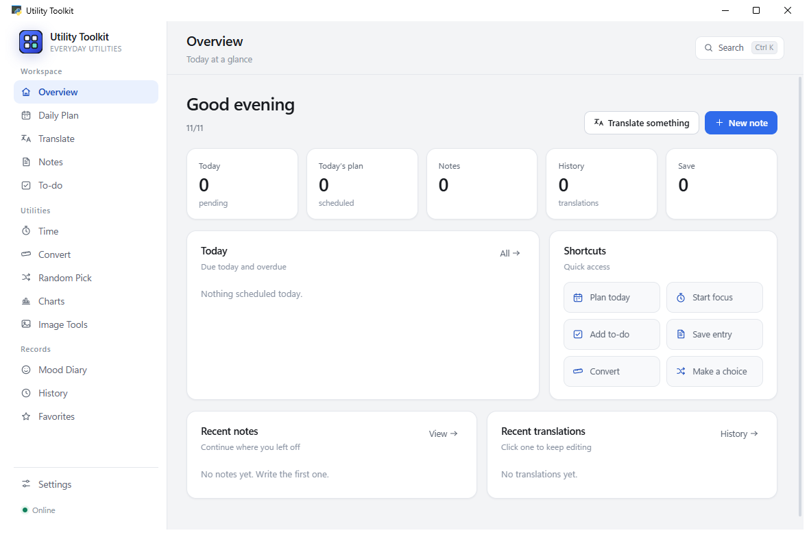
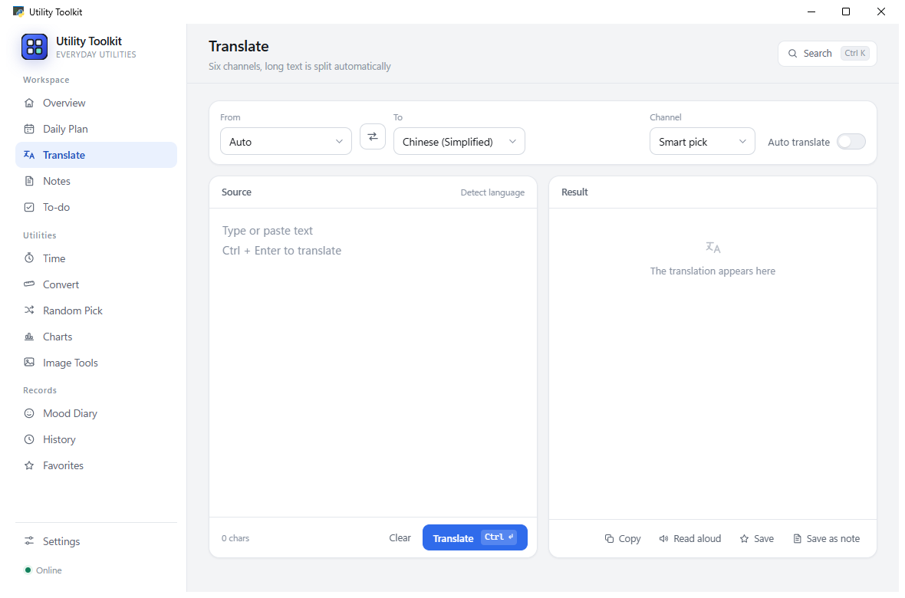
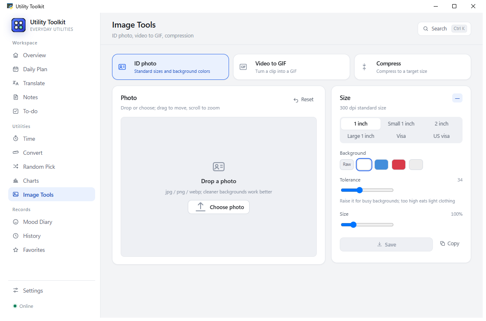
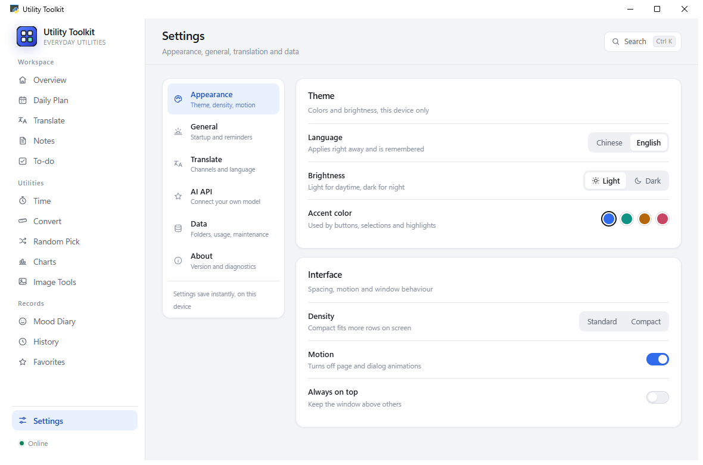
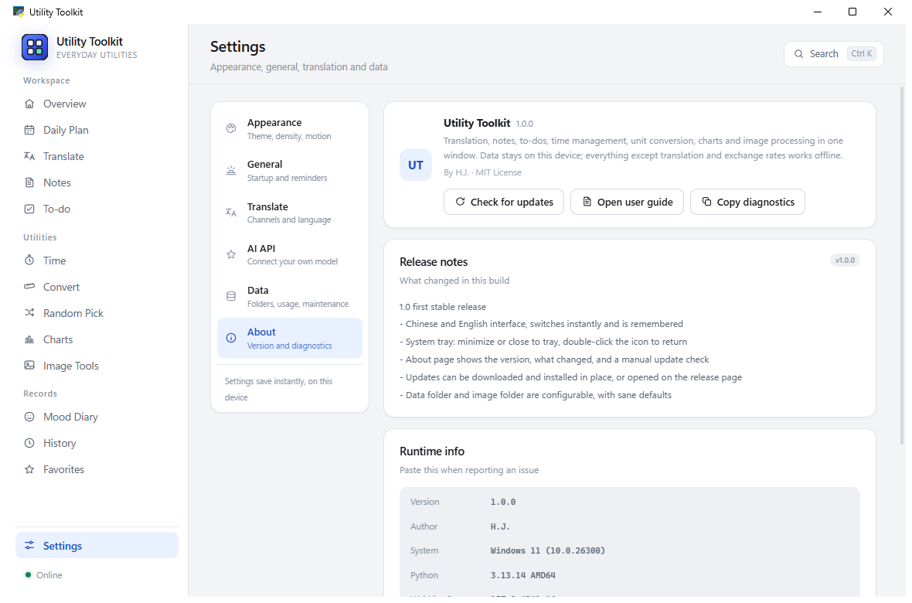

# 实用工具 · Utility Toolkit

[](https://github.com/HuaJiccc/practical-tools/releases/latest)
[](https://github.com/HuaJiccc/practical-tools/releases)
[](LICENSE)


English | [简体中文](README.md)

A local-first toolbox for Windows. Thirteen everyday utilities share a single window — translation,
notes, to-dos, day planning, timers, unit conversion, charts, image processing. Everything is stored
on your own disk. No account, no telemetry, nothing uploaded.

Built with Python and pywebview. The backend uses only the Python standard library: no compiled
modules, no bundled ffmpeg, no CDN assets. MIT licensed.



## Download and install

Latest build: [Releases](../../releases/latest)

- `PracticalTools-<version>-Setup.exe` — installer. Installs per-user, **no administrator rights, no UAC prompt**.
- `PracticalTools-<version>-Portable.exe` — single executable, run it from any folder.

Requires 64-bit Windows 10 or 11. Python is **not** required — nothing else to install.

> The installer wizard is Chinese-only (Inno Setup, single language). The application itself switches
> between Chinese and English at runtime: **Settings → Appearance → Language**. First launch is Chinese.

| | |
|---|---|
| Install location | `%LOCALAPPDATA%\Programs\实用工具` by default; the directory name follows the Chinese product name and can be changed during setup |
| Shortcuts | Start menu entry and an uninstaller; desktop shortcut optional |
| Runtime | WebView2, shipped with Windows 11 and most updated Windows 10 installs. The installer detects it and links to the download if missing |
| Data | `%LOCALAPPDATA%\实用工具\data`, **kept on uninstall** and reused after reinstall |
| Portable data | A `data` folder next to the executable — copy the whole folder to move machines |
| Uninstall | Settings → Apps → Installed apps, or the Start menu entry |

If the data location is not writable (for example, installed under `C:\Program Files`), the app falls
back to `%APPDATA%` automatically.

## Features

### Workspace

| Tool | What it does |
|---|---|
| **Overview** | Today's to-dos, schedule and recent records in one place, with one-click entry into each tool |
| **Day planner** | Lay out a day in time blocks, tag and tick them off, pull items in from the to-do list |
| **Translate** | Six providers with automatic fallback, long text split into chunks, results saved to history or favourites |
| **Notes** | Autosaves as you type; the title is taken from the first line, notes can be grouped |
| **To-dos** | Natural-language due dates (`tomorrow 3pm pay rent` works in Chinese), desktop notification when due, recurring tasks |

### Utilities

| Tool | What it does |
|---|---|
| **Time** | Pomodoro timer, countdown days, world clock |
| **Unit converter** | Length, weight, temperature, area, volume, speed, data and currency — eight categories |
| **Random picker** | Spinning wheel; option sets can be saved and reused |
| **Data to chart** | Paste two columns and get a chart, or drop in an `.xlsx` / `.csv` file |
| **Image tools** | ID-photo background removal, video to GIF, image compression — all three in one tab, all local |

### Records

| Tool | What it does |
|---|---|
| **Mood diary** | One line a day, reviewed by month |
| **History** | Translation history, searchable |
| **Favourites** | Kept indefinitely, never auto-cleaned |

Global search on `Ctrl+K`. Dark and light themes, four accent colours, adjustable density, motion on/off.

### Interface language and tray

- **Chinese / English, switched live.** Settings → Appearance → Language. No restart: window title,
  tray menu and About page follow along, and the choice is remembered.
- **Tray icon.** Minimising hides the window to the tray by default. The first time you press the close
  button it asks once — *keep running in the tray* or *quit* — then remembers your answer. To be asked
  again, set Settings → General → On window close back to *ask me*. Left-click the tray icon to restore
  the window; right-click for settings, the data folder, or quit.
- **Update check.** The About page can look for a newer release and, when one exists, download the
  installer, verify its SHA-256 and launch it. You can also open the release page and download by hand.

## Screenshots

| Translate | Image tools |
|---|---|
|  |  |

| Settings | About |
|---|---|
|  |  |

All screenshots are the light theme with the Chinese UI; both switch from Settings.

## Implementation notes

- **Image processing happens entirely in the frontend**, with no ffmpeg:
  - The GIF encoder is hand-written: 15-bit colour-key histogram → median-cut to 256 colours → variable-length LZW
  - Background removal floods from all four edges, comparing against a copy of the original pixels
  - Compression binary-searches `canvas.toBlob` quality, and only downscales if the target size is still missed
  - Frame grabbing uses `requestVideoFrameCallback` sampled by `mediaTime`, which also works for unindexed webm
- **Excel parsing without SheetJS**: zips are inflated with `DecompressionStream('deflate-raw')`
- **Zero external assets**: no CDN, no `node_modules`, no web fonts; icons are hand-written SVG symbols
- **Preferences are mirrored to disk**: localStorage is origin-scoped and the local server port changes
  every launch, so theme, density and similar settings are also written to `data/ui_prefs.json`

## Running from source

Requirements: Windows 10/11, [WebView2 Runtime](https://developer.microsoft.com/microsoft-edge/webview2/),
and **Python 3.10+** (developed and packaged on 3.13).

```bash
pip install -r requirements.txt
python app/app.py
```

Data is written to `data/` unless `PERSONALTOOLS_DATA` points elsewhere.

## Building

```bash
# 1. Freeze the executable (dist/实用工具.exe, about 13 MB)
pip install pyinstaller
python -m PyInstaller --noconfirm --clean 实用工具.spec

# 2. Build the installer (needs Inno Setup 6.7+; output in dist-installer/)
ISCC.exe installer\app.iss
```

`installer/app.iss` owns the licence page, install directory selection, shortcuts, the uninstall entry
and the data-directory config written at install time. To bump the version or swap the icon, edit the
`#define` block and `[Setup]` section at the top of that file only.

## Layout

```
app/
  app.py           Entry point: window, UiApi injection, local HTTP server
  aitranslate.py   Extra translation channels (AI endpoints, Tencent interact)
  uistore.py       UI-side storage (planner, categories, pomodoro, countdowns, mood, charts, prefs)
  tray.py          Tray icon via Shell_NotifyIcon, pure ctypes, no pystray
  update.py        Update check and installer download (custom manifest or GitHub Releases)
  ptools/          Core: standard library only, from storage to translation
  web/             Frontend: index.html + style.css + app.js + i18n.js, no framework
assets/            Application icon
installer/         Inno Setup script and licence text
dev/               30 self-test scripts: regression, image stress, tray, language, update, install/uninstall
docs/              Screenshots and the user guide
```

## Core (`app/ptools`)

The whole backend lives in this one package. **Python standard library only** — no `.pyd`, no compiled
artefacts, no third-party packages:

| Layer | Modules | Responsibility |
|---|---|---|
| Storage | `config` `store` `notes` `picker` `todo` `currency` | Settings, history, notes, picker sets, to-dos, FX cache |
| Work | `nlptime` `units` `languages` `translate` `aihint` | Chinese time parsing, unit conversion, language table, four translation channels, AI parsing |
| System | `clipboard` `notify` `network` `httpclient` | Clipboard, toast notifications, online probe, HTTP with gzip/deflate |
| Wiring | `server` `api` | Loopback HTTP server, the method surface the UI calls |

Change behaviour by editing the source; `python app/app.py` picks it up, no rebuild needed.
`dev/dev_ptools_diff.py` holds a differential test suite against the previous implementation — see
[BUILD.md](BUILD.md).

## Data

All state is plain JSON in the data directory:

```
settings.json      settings, including AI API keys (plaintext, local only)
notes.json         notes
todo_data.json     to-dos
plan_data.json     day planner
mood_diary.json    mood diary
history.json       translation history
ui_prefs.json      UI preferences (theme, density, start page, …)
exports/           files saved by the image tools
backup/            copies produced by "back up data"
```

Copy the whole directory to move to another machine. Both the data directory and the image export
directory are configurable in Settings → Data.

## Known limitations

- Windows only — depends on WebView2 and a few Win32 calls
- World clock and currency rates need a network connection; everything else works offline
- Translation goes through public web endpoints of each provider and can break when they change
- The 影视书籍 (media) module was removed in v2.0; `ptools/media.py` is a stub that raises
- Natural-language dates cover common Chinese phrasing (`明天下午三点`, `12月25日`, `每周一`),
  not dialects or other languages

## Contributing

Bugs and feature requests go to [Issues](../../issues); pull requests are welcome. If you touch the
core (`app/ptools/`), run the differential tests first to make sure existing behaviour still matches:

```bash
python dev/dev_ptools_diff.py    # 87 checks against the previous implementation
python dev/dev_check_assets.py   # frontend asset reference check
```

See [dev/README.md](dev/README.md) for the helper scripts and [BUILD.md](BUILD.md) for internals and
the traps hit along the way.

## Disclaimer

The translation channels (Microsoft Bing, Youdao, Google, MyMemory, Tencent Interact) use those
services' **public web endpoints**, not official APIs. This project is for learning and technical
study; respect each provider's terms and do not use it commercially or for high-volume scraping.
For production use, apply for an official API, or configure your own OpenAI-compatible endpoint under
Settings → AI endpoint (presets included for DeepSeek, Qwen, Zhipu GLM, Kimi, SiliconFlow, OpenAI
and a local Ollama).

## License

[MIT](LICENSE) © 2026 H.J.
