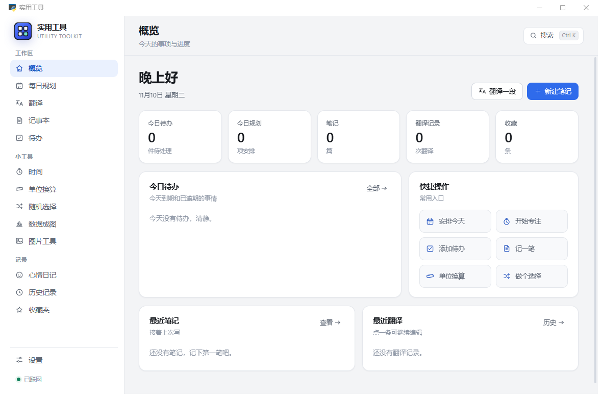
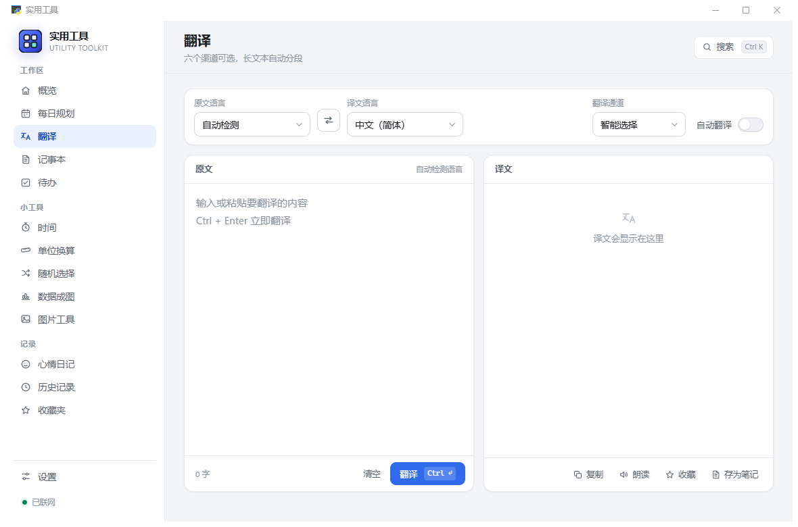
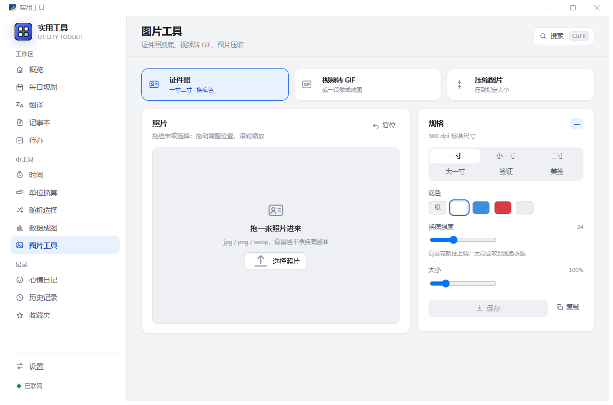
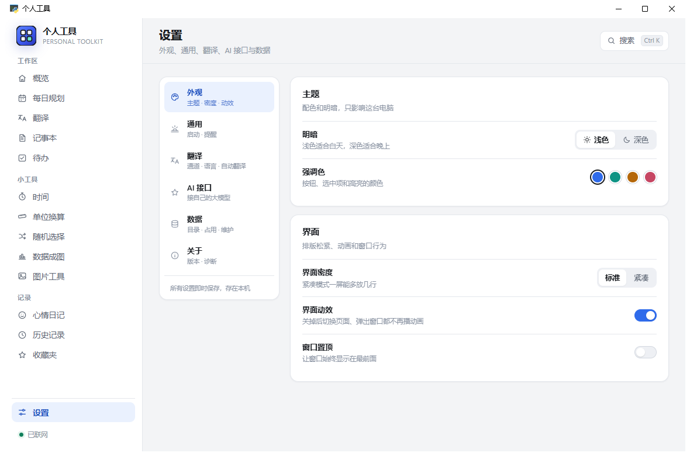
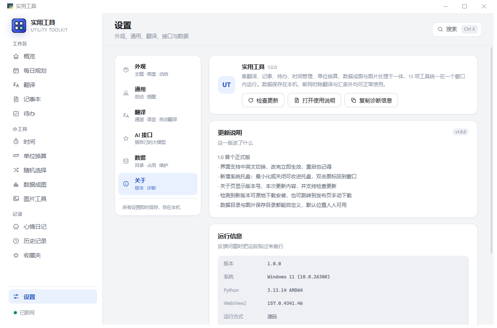

# 实用工具 · Utility Toolkit

[](https://github.com/HuaJiccc/practical-tools/releases/latest)
[](https://github.com/HuaJiccc/practical-tools/releases)
[](LICENSE)


一个运行在 Windows 上的本地工具集合。翻译、记事、待办、时间管理、图片处理等 13 项功能
整合在同一个窗口内，数据保存在本机，无需注册账号，也不会上传。

A local-first Windows toolbox built with pywebview. 13 everyday utilities in one window,
no account, no cloud, everything stays on your disk.

作者 **H.J.**，MIT 协议，Python 与前端代码全部开源，没有预编译的黑盒模块。



## 下载与安装

到 [Releases](../../releases/latest) 下载最新版本。文件名以 `-Setup.exe` 结尾的是安装程序，
双击按向导完成；以 `-Portable.exe` 结尾的是免安装版，单个文件，双击就能运行。

| 项目 | 说明 |
|---|---|
| 权限 | 默认装到当前用户目录（`%LOCALAPPDATA%\Programs\实用工具`），**不需要管理员权限**，不弹 UAC |
| 安装向导 | 欢迎页 → 许可协议 → 选择安装目录（可自由更改）→ 附加任务 → 完成 |
| 快捷方式 | 开始菜单、「卸载 实用工具」，桌面快捷方式可选 |
| 运行环境 | **不需要另外安装 Python 或其它运行时**。界面依赖的 WebView2 在 Windows 11 与较新的 Windows 10 上随系统提供，安装时会自动检测，缺失时给出提示与下载入口 |
| 数据位置 | `%LOCALAPPDATA%\实用工具\data`，卸载时保留，重新安装后仍可继续使用 |
| 卸载 | 「设置 → 应用 → 已安装的应用」或开始菜单中的「卸载 实用工具」 |

也提供免安装版（Release 里 `-Portable.exe` 那个）：放入任意文件夹双击运行，数据存放在
它旁边的 `data` 里，整个文件夹复制即可换机器。

## 功能

### 工作区

| 功能 | 说明 |
|---|---|
| **概览** | 汇总今日待办、规划与最近记录，常用操作一键进入 |
| **每日规划** | 以时间块方式安排一天，支持分类与完成状态，可导入待办 |
| **翻译** | 6 条渠道自动兜底，长文本自动分段，结果可留存与收藏 |
| **记事本** | 自动保存，标题取自首行，支持分类管理 |
| **待办** | 快速创建任务，支持自然语言时间识别（如「明天下午三点交房租」），到点系统通知 |

### 小工具

| 功能 | 说明 |
|---|---|
| **时间** | 番茄钟、倒数日与世界时钟 |
| **单位换算** | 长度、重量、温度、面积、体积、速度、数据、汇率共 8 类 |
| **随机选择** | 轮盘抽取，选项可保存复用 |
| **数据成图** | 粘贴两列数据即时生成图表，也支持直接拖入 `.xlsx` / `.csv` |
| **图片工具** | 证件照换底、视频转 GIF、图片压缩，三项合并在同一页签内，全部本地处理 |

### 记录

| 功能 | 说明 |
|---|---|
| **心情日记** | 每日一句，按月回顾 |
| **历史记录** | 翻译记录自动留存，可检索 |
| **收藏夹** | 长期保存，不受自动清理影响 |

全局搜索 `Ctrl+K`，支持深色 / 浅色主题、四套强调色、界面密度与动效开关。

### 界面语言与托盘

- **中文 / English 即时切换**：设置 → 外观 → 界面语言。不用重启，窗口标题、
  托盘菜单、关于页内容都跟着变，选择会被记住。
- **常驻托盘**：最小化默认收进托盘。点 × 关闭时要不要留在后台，第一次会问你一次：
  「收进托盘」还是「直接退出」；选过就照做，不再打扰。想改回每次询问，到
  设置 → 通用 → 关闭窗口时 里选「先问我」。左键单击托盘图标回到窗口，
  右键菜单可打开设置、打开数据目录或退出。
- **检查更新**：关于页可以查是否有新版本。有新版时能直接下载并启动安装程序，
  也可以打开发布页手动下载。

## 界面

| 翻译 | 图片工具 |
|---|---|
|  |  |

| 设置 | 关于 |
|---|---|
|  |  |

截图均为浅色主题 + 中文界面；深色主题与英文界面在设置里一键切换。

## 实现上的几个选择

- **图片处理全部在前端完成**，没有塞 ffmpeg：
  - GIF 编码器为手写实现（15 位色键直方图 → 中位切分 256 色 → 变长 LZW）
  - 证件照换底使用四边洪水填充，比较时读取原始像素副本
  - 压缩使用 `canvas.toBlob` 二分搜索质量，仍超出目标才退而缩小尺寸
  - 抓帧使用 `requestVideoFrameCallback` 按 `mediaTime` 采样，对无索引的 webm 同样可靠
- **Excel 解析不依赖 SheetJS**：用 `DecompressionStream('deflate-raw')` 自行解压 zip
- **零外部资源**：没有 CDN、没有 `node_modules`、没有网络字体，图标为手写 SVG symbol
- **偏好写回磁盘**：localStorage 按源隔离，而本地服务端口每次启动都会变，
  因此主题、密度等偏好另存一份 `data/ui_prefs.json`

## 从源码运行

### 环境要求

- Windows 10 / 11
- [WebView2 Runtime](https://developer.microsoft.com/microsoft-edge/webview2/)（Win11 自带，Win10 多数已装）
- **Python 3.10 及以上**（开发与打包用的是 3.13）

```bash
pip install -r requirements.txt
python app/app.py
```

数据默认写到 `data/`（可用环境变量 `PERSONALTOOLS_DATA` 指定别处）。

### 构建

```bash
# 1. 打包可执行文件（产物 dist/实用工具.exe，约 13 MB）
pip install pyinstaller
python -m PyInstaller --noconfirm --clean 实用工具.spec

# 2. 生成安装程序（需 Inno Setup 6.7+，产物 dist-installer/*.exe）
ISCC.exe installer\app.iss
```

安装脚本 `installer/app.iss` 负责许可协议页、安装目录选择、快捷方式、卸载项，
以及安装时写入数据目录配置。更换版本号或图标只改该文件顶部的 `#define` 与 `[Setup]`。

## 目录结构

```
app/
  app.py           入口：创建窗口、注入 UiApi、起本地 HTTP 服务
  aitranslate.py   翻译的扩展通道（AI 接口 / 腾讯交互翻译）
  uistore.py       界面侧独立存储（规划 / 分类 / 番茄钟 / 倒数日 / 心情 / 图表 / 偏好）
  tray.py          系统托盘（Shell_NotifyIcon，纯 ctypes，不依赖 pystray）
  update.py        检查更新与下载安装包（支持自定义清单与 GitHub Releases 两种格式）
  ptools/          内核：纯标准库，无第三方依赖，从存储到翻译全在这里
  web/             前端：index.html + style.css + app.js + i18n.js，无框架
assets/            应用图标
installer/         安装程序脚本与许可协议文本
dev/               自测脚本 30 个：功能回归、图片压测、托盘、语言、更新、安装/卸载（见 dev/README.md）
docs/              截图与使用说明
```

## 内核 `app/ptools`

内核全在这一个包里，**只有 Python 标准库**，没有 `.pyd`、没有编译产物、没有第三方包：

| 层 | 模块 | 管什么 |
|---|---|---|
| 存数据 | `config` `store` `notes` `picker` `todo` `currency` | 设置、历史、记事、随机选择、待办、汇率缓存 |
| 干活的 | `nlptime` `units` `languages` `translate` `aihint` | 中文时间解析、单位换算、语言表、四个翻译渠道、AI 识别 |
| 碰系统 | `clipboard` `notify` `network` `httpclient` | 剪贴板、系统通知、在线探测、HTTP（含 gzip/deflate） |
| 组装 | `server` `api` | 本地回环 HTTP 服务、给界面的方法集合 |

想改行为直接改源码，改完 `python app/app.py` 就能看到效果，不需要重新编译。
`dev/dev_ptools_diff.py` 里有一套新旧实现的对照测试，说明见 [BUILD.md](BUILD.md)。

## 数据

所有数据都是数据目录下的普通 JSON：

```
settings.json      设置（含 AI 接口的 Key，明文，仅存本机）
notes.json         记事本
todo_data.json     待办
plan_data.json     每日规划
mood_diary.json    心情日记
history.json       翻译历史
ui_prefs.json      界面偏好（主题、密度、启动页等）
exports/           图片工具保存的成品
backup/            「备份数据」生成的副本
```

换机器时复制整个数据目录即可。

**两个目录都可以更改**：「设置 → 数据」可分别指定数据目录与图片保存目录。
安装版默认在 `%LOCALAPPDATA%\实用工具\data`，免安装版默认在 exe 旁的 `data`；
若该位置不可写（例如装在 `C:\Program Files`），程序会自动改用 `%APPDATA%`，无需手动配置。

## 更新日志

各版本变更见 [CHANGELOG.md](CHANGELOG.md)。

## 已知限制

- 仅支持 Windows（依赖 WebView2 与部分 Win32 调用）
- 世界时钟、汇率换算需要联网，其余功能离线可用
- 翻译渠道走的是各服务的公开网页接口，服务方改版即可能失效
- 「影视书籍」模块在 v2.0 已移除，`ptools/media.py` 只保留一个会抛错的占位
- 中文时间解析覆盖常见说法（`明天下午三点`、`12月25日`、`每周一`），
  不含方言与外语表达

## 反馈与参与

发现 bug、或者想加个功能，到 [Issues](../../issues) 提；改代码请直接开 Pull Request。

改动内核（`app/ptools/`）时请顺手跑一遍对照测试，确认没有把既有行为改坏：

```bash
python dev/dev_ptools_diff.py    # 新旧实现逐项对照，87 项
python dev/dev_check_assets.py   # 前端资源引用检查
```

`dev/` 里的脚本怎么用见 [dev/README.md](dev/README.md)，实现细节与踩过的坑见 [BUILD.md](BUILD.md)。

## 免责声明

翻译中的「微软必应 / 网易有道 / Google / MyMemory / 腾讯交互翻译」使用的是这些服务
**公开的网页接口**，并非官方开放 API。本项目仅用于学习与技术研究，请遵守各服务商的
使用条款，不要用于商业用途或高频批量调用。需要稳定商用请申请官方 API，或在
「设置 → AI 接口」中配置自己的 OpenAI 兼容接口（已内置 DeepSeek、通义千问、
智谱 GLM、Kimi、硅基流动、OpenAI、本地 Ollama 七个预设）。

## 协议

[MIT](LICENSE) © 2026 H.J.
